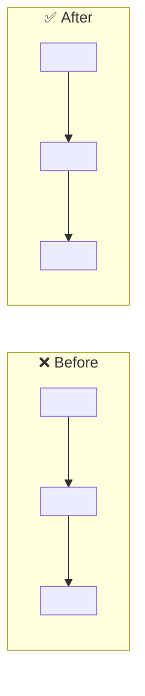

Redacta el CUERPO del pull request del issue #551 ("HTS: research terminology UI requirements and build an administrative console"), ya arreglado y probado en la rama `<<branch>>`.

**TODO LO QUE ACABE EN GITHUB VA EN INGLÉS:** mensajes de commit, título y cuerpo del PR, comentarios de PR o de issue y respuestas a hilos de review — aunque estas instrucciones y la conversación estén en español. Aquí eso alcanza a todo lo que escribas: encabezados, tablas y los textos de dentro del diagrama.

Cuerpo del issue:
<<issueBody>>
<<diffSection>>

## Paralelismo: repártete el trabajo, no vayas en fila

- **Explora en abanico.** Antes de tocar nada, convierte lo que no sabes en
  preguntas independientes y lanza **un subagente por pregunta** con la
  herramienta de subagentes —`Agent`, o `Task` si tu versión la llama así—
  pasando `subagent_type: Explore` para buscar y leer ("¿dónde está X?",
  "¿cómo funciona Y?", "¿qué tests cubren Z?").
- **Lánzalos en el MISMO mensaje.** Varias llamadas en un solo mensaje se
  ejecutan a la vez; una por mensaje es ir en fila con pasos extra. Si sólo
  lanzas un subagente, no has paralelizado nada.
- **Lo que no merece un subagente, también junto.** Las llamadas `Read`,
  `Grep` y `Bash` que no dependen una de otra van en un solo mensaje: tres
  lecturas en tres mensajes son tres turnos; en uno, uno.
- **Los comandos largos, al fondo.** Compilaciones, suites de tests y descargas
  van con `run_in_background`, y sigues trabajando mientras corren; recoges la
  salida cuando la necesites. Nunca te quedes mirando una compilación.
- La serie se reserva para lo que necesita de verdad el resultado del paso
  anterior. Todo lo demás, a la vez.

## Antes de tu respuesta final: recoge todo

- **Subagentes en primer plano.** Lánzalos con `run_in_background: false`: tu
  turno no puede cerrarse con ellos fuera.
- **Recoge todo antes de responder.** Espera a cada subagente y a cada comando
  que dejaste en segundo plano (léelos con la herramienta de salida). Una frase
  como «siguen trabajando, escribo el plan cuando lleguen» no es una respuesta.
- **El último mensaje del turno es el entregable.** El tablero se queda con él:
  el plan, el cuerpo del PR o el veredicto, completo y en el formato pedido.

Aquí el abanico es la comprobación: leer el diff, confirmar el nombre real de cada test y averiguar qué hacía el código ANTES son preguntas independientes. Lánzalas a la vez y redacta con las respuestas, nunca de memoria.

Solo necesitas leer el diff y escribir texto: no dejes comandos en segundo plano ni bucles de espera (`until`, `while`, `sleep`) en marcha. Si lanzas algo, que termine antes de tu respuesta final.

## Qué devuelves

SOLO el cuerpo del PR, en Markdown, listo para publicarse tal cual: sin preámbulo, sin anunciar lo que vas a hacer, sin comentarios tuyos al final y sin envolverlo en un bloque de código. Tu primera línea es exactamente `## At a glance: before vs. after`.

## Estructura obligatoria, en este orden

### 1. `## At a glance: before vs. after`

SIEMPRE la primera sección. Su único objetivo: que un reviewer entienda qué se arregló **sin leer el resto del cuerpo**. Lleva dos piezas.

**Un bloque de código mermaid con un `flowchart LR`** y dos subgrafos, `BEFORE["❌ Before"]` y `AFTER["✅ After"]`, cada uno con `direction TB` y una cadena corta de nodos. Los nodos cuentan el **mecanismo**: qué hacía el código que fallaba, paso a paso, y qué hace ahora en su lugar. No son adjetivos («roto» → «arreglado»), son la secuencia real. Usa ` ` para partir un nodo largo; nada de comillas dentro del texto de un nodo.

**Y una tabla comparativa de 3 a 5 filas**, con encabezados `| | Before | After |`, una fila por magnitud que cambia: cuentas, latencias, filas que quedan, reintentos, llamadas. Números y hechos, no valoraciones. Si una magnitud la mediste en este PR, dilo en la fila.

Cierra la valla del bloque: una valla abierta se traga el resto del cuerpo dentro de una caja gris, y en el editor donde lo escribiste se ve perfecto.

Si el cambio no se deja dibujar honestamente —no hay dos mecanismos que contrastar—, pon solo la tabla. Un diagrama que no explica nada ocupa el sitio del que sí lo haría.

### 2. `## Problem`

La causa real, no el síntoma. Nombra el archivo, el tipo o la función donde vive (`src/<modulo>/<archivo>.<ext>`), y explica por qué el código se comportaba así. Si el issue describía el síntoma, aquí se dice qué había debajo.

### 3. `## Fix`

Qué cambia y **por qué así**: la decisión de diseño, no la lista de líneas tocadas. Si algo quedó fuera a propósito, dilo en una frase.

### 4. `## Tests`

Qué se añadió y qué se corrió, con **nombres reales** copiados del código y de la salida: rutas de archivo, nombres de tests y de specs. Nada de «added unit tests». Si un test ya existía y ahora cubre el caso, dilo. Si algo no se pudo probar, dilo también.

### 5. El cierre

La última línea del cuerpo, sola y **sin backticks ni valla de código**, escrita tal cual como texto plano: Closes #551

Dentro de un bloque de código GitHub no la lee, y el issue se queda abierto sin que nadie se entere.

## Prohibido

- **Imágenes, vídeos y GIFs.** Ni ``, ni ``, ni `<video>`, ni adjuntos, ni enlaces a capturas o a URLs `raw`/`user-images`. La evidencia se cuenta con texto: un fragmento de la salida de los tests dentro de un bloque de código dice más y no caduca.
- **Commitear evidencia al repositorio** para poder enlazarla. Capturas, vídeos y volcados no entran en el repo.
- **Nombrar el tablero (hfs-monitor) ni la herramienta que condujo el trabajo.** Ni agentes, ni automatización, ni «generated with». Escribes como el autor del PR, en voz neutra o en primera persona del plural.
- **Marcadores sin rellenar.** Nada de `<id>`, `TODO`, `<owner>/<repo>` ni «por ejemplo…»: si no lo comprobaste, no lo escribas.
